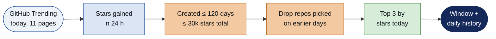
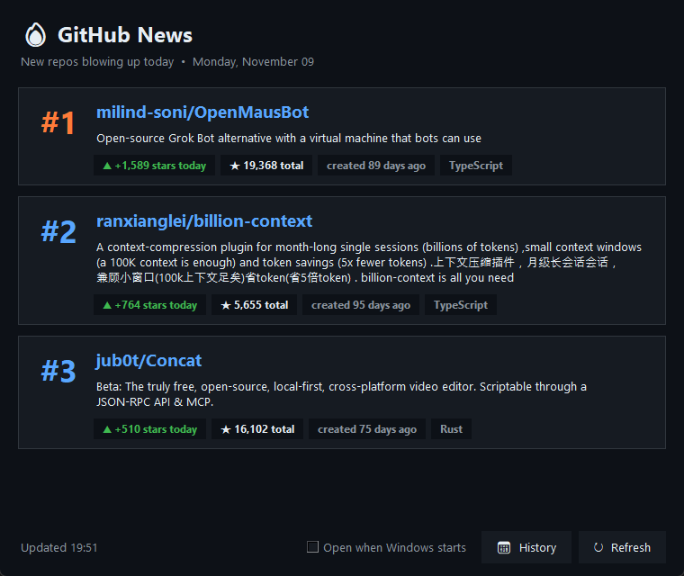
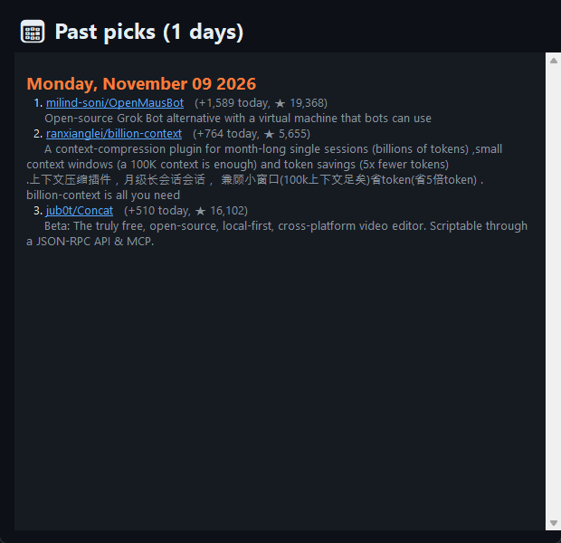

<h1 align="center">GitHub News</h1>

<b>Which new GitHub repos are blowing up today?</b> 
Three picks a day, never the same repo twice. Opens itself when Windows starts.

## How it works

## The app

<table>
<tr>
<td width="55%"></td>
<td width="45%"></td>
</tr>
<tr>
<td><b>Today's picks.</b> Click a card to open the repo. Green: stars gained today.
<i>Refresh</i> (or <kbd>F5</kbd>) checks again; <kbd>Esc</kbd> closes.</td>
<td><b>History.</b> Every day's 3 picks, newest first. Click a name to open it.</td>
</tr>
</table>

## Install and run

**Windows, no typing:** double-click `GitHub News.bat` (or `githubnews.pyw`). Needs Python 3.10+, nothing else.

The first start does the setup for you:

| What | Where | Undo |
|---|---|---|
| Opens at every Windows login | Startup folder shortcut | Untick *Open when Windows starts* |
| Desktop shortcut | `GitHub News` on your desktop | Delete it |

If you're logged in with the [GitHub CLI](https://cli.github.com/) (`gh auth login`), the app uses that login
for a much higher API limit. Without it, it still works.

## Rules for a pick

| Rule | Default | Change in `githubnews.pyw` |
|---|---|---|
| Gaining now | On GitHub Trending today, ranked by stars gained in the last 24 h | – |
| New | Created in the last 120 days | `MAX_AGE_DAYS` |
| Not famous yet | 30,000 stars or fewer | `MAX_TOTAL_STARS` |
| Fresh every day | Never shows a repo picked on an earlier day | – |
| How many | 3 | `TOP_N` |
| Languages scanned | all + Python, TypeScript, JavaScript, Rust, Go, C++, Java, Jupyter, Swift, C# | `LANGUAGES` |

If fewer than 3 trending repos pass, the rest are filled with the most-starred repos created this week
(marked *brand new this week*).

## Files

| Path | Contents |
|---|---|
| `githubnews.pyw` | The whole app: scraper, filters, window |
| `GitHub News.bat` | Double-click launcher |
| `history.json` | Every day's picks (created on first run, not committed) |
| `cache.json`, `repo_info_cache.json` | Saved results so reopening is instant (3 h / 12 h) |
| `error.log` | Only appears if something went wrong |

## Limits

GitHub Trending has no official API, so the app reads the web page; if GitHub changes its layout, picks may
stop appearing until the scraper is updated. "Stars today" is GitHub's own number.

MIT License. Data from github.com.
